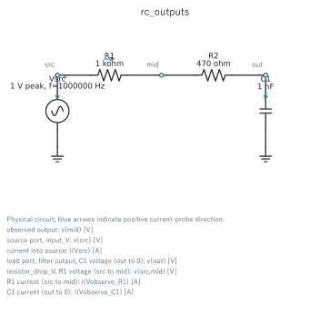
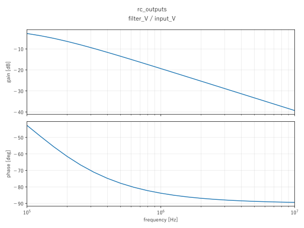
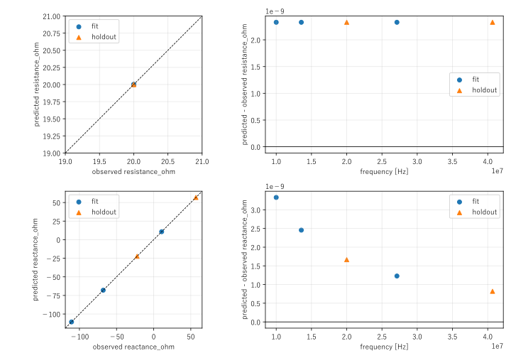

# PCD 回路モデリング統合マニュアル

対象版は **PCD 0.22.1**。回路を記述し、指定した条件で計算し、設計値または有効な端子パラメータを求めるエンジニア向けの利用・入出力仕様である。

PCDは、固定した装置回路が負荷変動と設備の調整範囲の中で電気的制約を満たすかを判定する。既存SPICEの順計算、素子値の設計探索、校正済み複素V/Iによる端子モデル同定を、同じ計算・計測経路で実行する。

最初に動かす場合は[実行環境と最初の計算](#quickstart)、自分の回路を作る場合は[モデリングの手順](#modeling)から読む。項目名と式はそのまま検索できる形で記す。

## 目次

1. [用途と適用範囲](#scope)
2. [実行環境と最初の計算](#quickstart)
3. [モデリングの手順](#modeling)
4. [入力の共通規則](#input)
5. [任意回路と外部SPICE](#circuit)
6. [整合回路の設計](#network)
7. [負荷モデルの選択と物理的意味](#loads)
8. [端子モデルの同定](#identification)
9. [計測面 数値計算 部品ストレス](#measurement)
10. [回路図 グラフ 数値表](#output)
11. [結果の状態と保存仕様](#results)
12. [有用性を確認する実行例](#evidence)
13. [CLIとPython API](#commands)
14. [上級入力と拡張](#advanced)
15. [開発と再現検証](#development)
16. [よくある問題](#troubleshooting)
17. [個別検証と研究資料](#references)

<a id="scope"></a>

## 1 用途と適用範囲

| 求めたいこと | 入力と操作 | 得られる判断 |
|---|---|---|
| 既存回路の応答 | 素子列またはSPICEを`sim-run` | 指定時刻・周波数でのV/I、追加プローブ、電気的指標 |
| RLC値を決める | `parameters.design`、目標、制約を指定して`run` | 評価した候補の順位、選択回路、制約余裕、再計算結果 |
| 負荷変動に耐える整合回路を選ぶ | `network`、負荷点、設備の調整値を指定して`run` | 条件ごとの調整値、反射、部品ストレス、全条件の合否 |
| 有効な負荷値を実測から推定する | 固定校正値、`latent`の範囲、fit/holdout観測を指定して`identify` | 推定値、未使用条件の誤差、局所感度、同定判定 |
| 保存結果を考察する | 成功した単体runを`analyze` | 計測結果、回路図、波形、伝達比、高調波と対応CSV |

PCDが扱う境界は電気的な端子・基準面である。CCP/ICPの有効回路は、その端子から見える損失やリアクタンスを表す。電子密度、化学反応、温度、イオンエネルギー分布、製造歩留まりを求めるには、それぞれを裏付ける別のモデルと観測が必要になる。

複数電源を含む回路は計算できるが、標準の反射・電力判定は選択したsource-portを基準とする。多端子Sパラメータ解析や、ICPとCCPの結合を一般的な多ポートモデルとして同定する入口は提供していない。

<a id="quickstart"></a>

## 2 実行環境と最初の計算

### 2.1 インストールと起動

Python 3.10以上とngspiceが必要になる。チェックアウトから再現する場合は、リポジトリのルートで実行する。

```powershell
uv sync --frozen --group dev
uv run --frozen python -m pcd solver-diagnose --json
uv run --frozen python -m pcd validate-case examples/circuit_transient.yaml --plan
uv run --frozen python -m pcd sim-run examples/circuit_transient.yaml --run-root runs/first --json
```

Windowsではコンソール版`ngspice_con.exe`を優先する。実行ファイルがPATHにない場合、任意回路のYAMLでは`execution.executable`、上級入力では`solver.executable`に指定する。診断には`solver-diagnose --executable PATH --json`を使う。

wheelから利用する場合は、配布されたファイル名を指定してインストールする。

```powershell
python -m pip install circuit_design_platform-0.22.1-py3-none-any.whl
python -m pcd --help
```

wheelにはこのマニュアル・図・完全なexamplesを同じ原本から収録する。インストール先は次のコマンドで確認できる。

```powershell
python -c "from pathlib import Path; import sysconfig; print(Path(sysconfig.get_path('data')) / 'share' / 'pcd' / 'docs' / 'manual-ja.md')"
```

以降の`pcd`コマンドは、チェックアウトでは`uv run --frozen python -m pcd`、インストール環境では`python -m pcd`へ置き換える。wheel利用者は`share/pcd/examples`ディレクトリ全体を作業場所へコピーし、その親ディレクトリで例のコマンドを実行する。`bench/`、個別検証・研究資料、開発用の品質コマンドはソースのチェックアウトを対象とする。

### 2.2 一つのYAMLでRC回路を計算する

次を`case.yaml`として保存する。抵抗とコンデンサは固定値であり、最適化の設定は不要である。

```yaml
schema: pcd.rf.v1
case_id: first_rc
parameters:
  fixed: {R: "1 kohm", C: "1 nF"}
source:
  type: voltage_pulse
  v1_V: 0
  v2_V: 5
  rise_s: "2 ns"
  fall_s: "2 ns"
  width_s: "3 us"
  period_s: "4 us"
circuit:
  output_node: out
  components:
    - {ref: R1, n1: src, n2: out, value: R}
    - {ref: C1, n1: out, n2: 0, value: C}
analysis:
  tran: {step_s: "2 ns", stop_s: "2 us"}
output: {}
```

```powershell
pcd validate-case case.yaml --plan
pcd sim-run case.yaml --run-root runs/first_rc --json
```

`source`の正端子は省略時`src`、負端子は`0`。`0`はSPICEの基準節点である。`output: {}`を付けると、計算後に適用可能な図を自動作成する。省略時も数値と実行証跡は保存される。

返された`run_dir`の`summary.json`から、`artifacts.waveform`と`output.summary`を辿る。理想ステップ近似では時定数`RC=1 us`、2 us後の出力は`5(1-exp(-2)) ≈ 4.32 V`である。例は2 nsの立上りを持つため、比較ではその差を考慮する。

この2 us計算は4 us周期の電源について定常周期を判定する長さではない。立上り応答の考察に使い、定常高調波が必要なら十分な周期数まで`stop_s`を延ばす。

<a id="modeling"></a>

## 3 モデリングの手順

1. **判断したい量を決める。** 反射、出力波形、受入電力、部品ストレス、負荷パラメータのどれを判断に使うかを決める。
2. **基準面を決める。** ケーブル、治具、feedthrough、コイルを回路側と負荷側のどちらへ含めるかを記録する。同じ寄生を二重に含めない。
3. **観測に見合うモデルを選ぶ。** R+jXの一点しかなければ一点モデルから始める。多周波数の観測や校正情報がある場合に有効CCP/ICPモデルを使う。
4. **変更できる値を役割別に分ける。** 固定装置、校正値、外部条件、設備調整値、設計値、未知負荷値を分離する。
5. **解析とプローブを決める。** 定常線形応答にはAC、立上り・パルス・非線形応答には過渡を選ぶ。負荷電力には負荷端子のVと実際に流入するIを取得する。
6. **目的と合格条件を分ける。** 小さい反射や波形誤差を順位付けに使い、電流・電圧・損失上限を独立した制約にする。
7. **解決済み入力を確認して実行する。** `validate-case --plan`で役割・条件・解析・既定値を確認し、計算後は数値状態、工学的合否、出力完了を別々に読む。

同定時は観測した設備調整値を固定する。未知負荷と調整値を同時に自由化すると、調整によって観測誤差を隠し、負荷値の識別が難しくなる。

### 3.1 パラメータの役割

| グループ | 役割 | 実行中の扱い |
|---|---|---|
| `fixed` | 既設回路や選定済み値 | 固定 |
| `calibration` | 校正済みの治具・寄生 | 同定でも固定 |
| `operating` | 周波数、外部条件 | 条件行として与える |
| `control` | 設備で操作できる値 | 設計では条件別に選択。同定では観測値へ固定 |
| `design` | 設計で決める素子値 | `run`が探索 |
| `latent` | 観測から推定する有効値 | `identify`が探索 |

公差を持つ既設部品は、その実現値を`operating`として条件に列挙する。`fixed`に探索範囲を付けたり、同じ名前を二つの役割へ置いたりしない。列挙した頂点の合格率を製造歩留まりや連続公差領域全体の保証とは解釈しない。

<a id="input"></a>

## 4 入力の共通規則

通常入力は`pcd.rf.v1`のYAML一つで構成する。既存SPICE、観測表、目標波形など、独立した回路・データだけを必要に応じて別ファイルへ置く。設定ファイルの多段includeは必要ない。

| 項目 | 任意回路の入力 | 標準整合回路の入力 |
|---|---|---|
| 回路 | `circuit.components`または`circuit.file` | `network.type`と各素子の役割 |
| 値と所有者 | `parameters` | `network.fixed/search/tuning` |
| 電源と解析 | `source/sources`、`analysis` | 周波数、`drive_peak_V`、負荷から生成 |
| 条件 | `conditions`のinline行またはCSV | 負荷表、またはinline条件 |
| 順位付け | `objective` | 反射の最悪値を使用 |
| 合格条件 | `acceptance.metric_bounds` | 反射、部品、source、調整余裕の専用項目 |
| 計測と出力 | `measurement`、`output` | 同じ`measurement`、`output` |

`network`と`circuit`はどちらか一方を選ぶ。一般回路のYAMLと標準networkの項目を混在させない。

### 4.1 単位と構造

数値の基本単位はSI。公開YAMLでは`100 pF`、`13.56 MHz`、`2 us`、`50 ohm`、`4 Mrad/s`を一度だけSIへ変換する。対応接頭辞は`p/n/u/µ/m/k/M/G`。CSVとCLIのJSON上書き値にはSI数値を使う。

`unit`はSI単位の注記であり、数値を再変換する指定ではない。`default: 100, unit: pF`は拒否する。`default: "100 pF"`または`default: 1e-10, unit: F`を使う。SPICEファイルと`raw`行の構文は、そのままSPICEとして扱う。

YAML/JSONの重複キー、担当範囲内の未知キー、重複CSV列名、長さの異なるCSV行、非整数の試行数は入力エラーになる。誤記を既定値に置き換えない。プラグイン独自項目はその回路・負荷の設定か`extensions`に置く。

### 4.2 条件行と重み

任意回路の`conditions`はinline行または`{file: conditions.csv}`を受け付ける。`id/scenario_id`と`weight`は省略可能。行を列挙した順序と内容で評価し、暗黙の直積を作らない。異なるCSV列名には`columns`でパラメータ名との対応を指定する。

重みは正かつ有限で、平均・RMS・CVaRなどの集約へ使う。重みが小さくてもその条件の工学的制約を免除しない。条件の独立性は、IDが異なるだけでは成立しない。

### 4.3 一点の計算と探索の区別

`sim-netlist`は既定値で作るプレビュー。`sim-run`は一つの解決済み点を計算する。複数の条件・設計候補・調整値がある場合は、次のように対象を明示する。

```powershell
pcd sim-run examples/rf_ccp_lumped.yaml --scenario nominal_frequency --params '{"L1":1e-6,"C1":2e-10}' --json
```

必要に応じて`--controls`も指定する。全候補・全条件を比較する場合は`run`を使う。Pythonの公開`simulate_case`も同じ選択規則を適用する。

### 4.4 実行設定

| 入力 | `execution`で指定する項目 |
|---|---|
| 任意回路 | `solver/executable/timeout_s`、探索用`optimizer/trials/seed`、`control_state_limit` |
| 標準network | `solver`、`candidate_state_limit/control_state_limit` |

solverの既定は`ngspice_cli`。標準networkの状態上限は各250で、完全列挙できる範囲を指定する。任意回路の`trials`は提案候補数の上限であり、各候補の条件×control評価数とは異なる。同定のholdout・局所感度と、選択点の再計算も別に必要になる。`analysis.options`にはngspiceの解析optionを指定できる。

<a id="circuit"></a>

## 5 任意回路と外部SPICE

### 5.1 素子列と電源

R/L/Cは`ref/n1/n2/value`で記述し、`value`には定数またはパラメータ名を使う。`observe: true`で元の部品端子電圧と直列電流を保存する。`series_resistance_ohm`は有効ESR/DCR等を表す直列抵抗を追加する。

```yaml
circuit:
  output_node: load
  components:
    - {ref: L1, n1: src, n2: load, value: L, series_resistance_ohm: DCR, observe: true}
```

| 電源type | 主な入力 |
|---|---|
| `sine_voltage` | `dc_V`、`amplitude_V`、`frequency_Hz`、`phase_deg` |
| `voltage_pulse` | `v1_V`、`v2_V`、`delay_s`、`rise_s`、`fall_s`、`width_s`、`period_s` |
| `dc_voltage` | `voltage_V` |
| `current_dc` | `current_A`。電流観測用の直列電圧源を生成 |

共通項目は`name/p/n`とAC励振の大きさ・位相。電圧源には`ac_magnitude_V`、電流源には`ac_magnitude_A`を使う。正弦波のAC大きさは省略時に振幅を使用する。パルスやDCをAC解析にも使うときは、意図した小信号励振を明示する。

複数電源は`sources`へ列挙し、観測sourceを`measurement.current_source`、構造化電源のAC励振源を`analysis.ac.source`でそれぞれ選ぶ。source電圧を明示する場合は`measurement.source_voltage: v(p,n)`とし、選択したsourceの端子・極性に合わせる。

### 5.2 ACと過渡の指定

```yaml
analysis:
  ac: {sweep: dec, points: 20, start_Hz: "100 kHz", stop_Hz: "10 MHz"}
  tran: {step_s: "10 ns", stop_s: "20 us"}
```

AC一点は`ac: {frequency_Hz: "1 MHz"}`。一点指定と掃引指定は併記しない。`lin`の`points`は点数、`dec`は一桁当たり、`oct`は一オクターブ当たりの点数である。

過渡の`step_s`は出力要求に加えてngspiceの最大内部刻み`tmax`へも使う。実際に保存される時刻は適応刻みであり、等間隔配列とは限らない。`stop_s`は終了時刻、計算は0秒から開始する。細いパルスや急な入力変化を分解できる刻みを選ぶ。

### 5.3 既存SPICEの取り込み

```yaml
schema: pcd.rf.v1
case_id: imported_ac
circuit: {file: circuits/divider.cir, output_node: out}
parameters:
  fixed: {Rload: "50 ohm"}
analysis:
  ac: {frequency_Hz: "1 MHz"}
output: {}
```

この例の`circuits/divider.cir`は[実行可能な例](../examples/circuits/divider.cir)を参照する。ファイル名は入力YAMLからの相対パスとして解決する。

公開入力の既定は`format: deck`と`source_policy: preserve`。deckの先頭行はSPICEのタイトル。タイトルのない素子断片には`format: fragment`を指定する。独立電圧源が一意なら観測端子を解決し、曖昧な場合はsourceと電圧vectorを明示する。

元の回路の`.ac/.tran/.control/.op/.dc/.noise/.end`等の実行指示は、YAMLのAC/過渡要求へ置き換える。include/library依存を展開・保存するが、任意のSPICEジョブをそのまま実行する汎用ランチャーではない。

元sourceとYAML sourceの同名重複は拒否する。意図した同名置換に限って`source_policy: replace_named`を選ぶ。節点を共有することだけを根拠にsourceを削除しない。取り込んだ電流源を観測する場合は、直列の0 V電流計とsource-port電圧を明示する。

### 5.4 回路値の設計

[circuit_design.yaml](../examples/circuit_design.yaml)はRを固定し、Cを連続範囲で設計する例である。

```yaml
parameters:
  fixed: {R: "1 kohm"}
  design:
    C: {bounds: ["100 pF", "100 nF"], default: "1 nF", scale: log}
objective: {type: waveform_l2, waveform_file: advanced/target_rc.csv, metric: normalized_rmse}
acceptance:
  metric_bounds:
    peak_abs_voltage_V: {max: 4.9}
execution: {trials: 24, seed: 3}
```

上は回路・電源・解析へ追加する断片。完全な例を`pcd run examples/circuit_design.yaml --require-acceptance`で実行する。目標CSVは`time_s,voltage_V`で、計算時間が目標の範囲を覆う必要がある。

`objective.type`は`impedance_match`、`rf_load`、`waveform_l2`。`metric/direction/aggregation`で順位付けを指定できる。通常は前二者のうち`rf_load`が負荷電力の最大化、それ以外が損失の最小化を既定とする。`waveform_l2`のRMSEは目標の観測点上で比較する。

`aggregation`は`worst/mean/rms/cvar`。`worst`はminimize目的で最大値、maximize目的で最小値を使う。その他は条件の正規化重みで平均、二乗平均平方根、悪い側の尾部平均を求める。CVaRの尾部質量`cvar_alpha`や複数目的を直接設定するときは、上級入力の`study.objectives`を使う。

有限な`choices`はgrid、連続`bounds`はDEを既定とする。DEは数値の連続範囲を扱い、離散トポロジーを連続座標へ置き換えない。予算終了と収束、工学的合格は別の状態である。

<a id="network"></a>

## 6 整合回路の設計

標準networkは回路接続を選ぶ入口である。値・調整範囲・適用する負荷・合格条件はYAMLで与える。

| `network.type` | 接続 | 必須の部品名 |
|---|---|---|
| `l_match` | sourceから負荷へ直列L、負荷側へ並列C | `L1,C1` |
| `pi_match` | source側並列C、直列L、負荷側並列C | `C1,L1,C2` |
| `pi_match_harmonic` | piに、負荷側の直列LC分岐を追加 | `C1,L1,C2,Lh,Ch` |

各部品は`fixed`、`search`、`tuning`のいずれか一つへ置く。

```yaml
schema: pcd.rf.v1
case_id: load_window
frequency_Hz: "13.56 MHz"
network:
  type: pi_match
  fixed: {L1: "643 nH"}
  tuning:
    C1: ["480 pF", "670 pF", "890 pF"]
    C2: ["45 pF", "160 pF", "210 pF"]
load:
  type: impedance_table
  reference_plane: electrode_terminal
  evidence: {origin: supplied_terminal_data}
  points:
    - {resistance_ohm: 25, reactance_ohm: -80.77}
    - {resistance_ohm: 50, reactance_ohm: -80.77}
    - {resistance_ohm: 12.5, reactance_ohm: -80.77}
acceptance:
  reflected_power_fraction_max: 0.10
```

`fixed`は一つの装置値、`search: {C1: {values: [...]}}`はハードウェア候補、`tuning`は各条件で選べる設備設定である。上の例ではハードウェアは一つで、3負荷条件それぞれについて9調整値を比較する。

searchとtuningは正の一意な値を列挙する。標準networkは宣言した候補と調整値を完全列挙し、状態上限を超えると拒否する。既定のcandidate/control状態上限は各250。上限はサンプリング予算ではない。

### 6.1 反射 損失 ストレスの制約

反射制約は`reflected_power_fraction_max`または`reflection_magnitude_max`の一方を必ず指定する。前者は`|Gamma|²`の上限である。基準インピーダンス`reference_impedance_ohm`は既定50 Ωで、物理的な直列抵抗とは別の設定になる。

```yaml
drive_peak_V: 100
network:
  loss_ohm: {C1: 0.1, L1: 0.5, C2: 0.1}
acceptance:
  reflected_power_fraction_max: 0.10
  component_limits:
    L1: {current_rms_A_max: 1.0, loss_W_max: 0.5}
  source_limits: {current_rms_A_max: 1.0, apparent_power_VA_max: 50}
  control_margin_min: 0.20
  loss_balance_fraction_max: 1.0e-5
```

上はnetworkへ追加する設定断片。`component_limits`は`voltage_peak_V_max/voltage_rms_V_max/current_peak_A_max/current_rms_A_max/loss_W_max`、`source_limits`は`current_rms_A_max/apparent_power_VA_max`を受け付ける。損失制約にはその部品の`loss_ohm`、損失収支制約には観測した有効損失が必要になる。

絶対的な電圧・電流・損失制約には`drive_peak_V`を宣言する。省略した反射計算は1 V peak基準となり、図と信号辞書に`normalized_1V_peak`を記録する。その条件のW/V/Aを装置の駆動値と混同しない。

`control_margin`は調整範囲端で0、中央で1となる正規化余裕である。数値軸・条件の最悪値を使う。単一点の数値設定は中立の1、カテゴリ値は除外する。観測で端の値へ固定しても、その設定を中央と読み替えない。

<a id="loads"></a>

## 7 負荷モデルの選択と物理的意味

`reference_plane`と、その値を得た方法を`evidence`へ記録する。校正やde-embeddingはデータを入れる前に行う。表に測定由来と記載するだけでは、校正やモデル妥当性の検証を代行しない。

### 7.1 一点または測定周波数のR+jX

`impedance_point`は一つの周波数での`R+jX`を表す。`R>=0`を要求し、Xが正なら直列L、負なら直列Cで実現する。

```text
L = X / (2πf)               X > 0
C = -1 / (2πfX)            X < 0
```

この実現は指定周波数で一致する。生成したL/Cの式を測定済み帯域全体の性質とみなさず、この負荷は一点ACで評価する。複数の測定周波数は`impedance_table`の行として与える。

```csv
scenario_id,frequency_Hz,resistance_ohm,reactance_ohm,weight
point_a,10000000,25,-80,1
point_b,13560000,28,-60,1
```

```yaml
load:
  type: impedance_table
  file: chamber_impedance.csv
  reference_plane: electrode_terminal
  evidence: {origin: measured, deembedding: fixture_v3}
```

CSVに周波数を与える場合はトップレベルの`frequency_Hz`を省略する。行の周波数がsource、負荷実現の基準、AC一点のすべてへ使われる。行間の周波数補間は行わない。追加の来歴列は回路パラメータにしない。

### 7.2 準静的な時間変化

`impedance_profile`のCSVは`time_s,resistance_ohm,reactance_ohm`を持つ。時刻は非負で厳密な昇順、Rは非負、全値は有限とする。`frequency_Hz`、`drive_peak_V`、`weight`も各行へ与えられる。

各行は独立したAC一点であり、状態を次の行へ伝搬しない。RF周期より十分遅い包絡変化を局所定常とみなせる場合に使う。絶対電力を示すため、周波数と駆動振幅を各行またはcaseへ与える。各調整値の選択は可能だが、チューナーの移動時間や遅延は計算しない。

選択結果の`snapshot_response.csv`に、負荷R/X、source側入力R/X、反射、電力、調整値、制約を時刻順に保存する。実例は[rf_quasi_static_profile.yaml](../examples/rf_quasi_static_profile.yaml)。

### 7.3 有効CCPモデル

```text
Z_CCP(ω) = R_eff + jωL_eff + 1/(jωC_sheath_eq)
```

```yaml
load:
  type: ccp_lumped
  reference_plane: electrode_terminal
  evidence: {origin: qualified_fit, frequency_Hz: [10000000, 20000000]}
  parameters: {R_eff_ohm: 18, L_eff_H: "250 nH", C_sheath_eq_F: "120 pF"}
```

`R_eff`は基準面より下流で受け入れる総実電力を表す有効抵抗、LとCも端子から見える有効量である。電子・イオン・sheathの電力配分を個別に求める量ではない。

一点の複素V/Iは実数2観測なので、R/L/Cの3値を同時に自由化して一意性を主張しない。一つを独立校正で固定するか、多周波数・多条件で識別可能性を確認する。

### 7.4 有効ICPモデル

```text
Z_series(ω) = R_coil + jωL_coil + ω² L_reflected / (γ_secondary + jω)
Z_ICP(ω) = 1 / (1/Z_series(ω) + jωC_parallel)
```

```yaml
load:
  type: icp_transformer
  reference_plane: coil_terminal
  evidence: {origin: plasma_on_and_fixture_fit}
  parameters:
    R_coil_ohm: 0.2
    L_coil_H: "2 uH"
    reflected_inductance_H: "180 nH"
    secondary_damping_rate_rad_s: "4 Mrad/s"
    C_parallel_F: "20 pF"
```

`0<=L_reflected<=L_coil`、`γ_secondary>0`。減衰率は端子fitの有効値であり、独立した物理的根拠がある場合にのみ衝突周波数として解釈する。任意の`C_parallel`は理想的な端子サセプタンスで、容量結合による実電力加熱を表す枝ではない。

コイル・治具の校正、plasma-off/onの複素観測、多周波数の残差とholdoutがモデル選択の根拠になる。coil-portとelectrode-portの電力を単純加算してハイブリッド装置の総電力を作らない。

<a id="identification"></a>

## 8 端子モデルの同定

既知回路と校正値を固定し、有限な範囲を与えた`latent`だけを推定する。最初の完全な例は[terminal_identification.yaml](../examples/terminal_identification.yaml)と[観測CSV](../examples/terminal_observations.csv)である。

```powershell
pcd validate-case examples/terminal_identification.yaml --plan
pcd identify examples/terminal_identification.yaml --output runs/terminal --json
```

公開入力は`parameters.calibration/latent`と、次の短い同定設定を使う。

```yaml
identification:
  observations: {file: terminal_observations.csv}
  error_scale_ohm: 100
  fit_loss_max: 0.02
  holdout_loss_max: 0.03
  condition_number_max: 100
```

標準の観測列は次のとおり。電流は**sourceから回路へ供給する向き**のpeak phasorである。

```csv
frequency_Hz,voltage_re_V,voltage_im_V,current_re_A,current_im_A,partition
10000000,1,0,0.00158218328044895,0.00875247736869483,fit
20000000,1,0,0.0222536258692152,0.0248486906925447,holdout
```

`scenario_id`は任意。標準列ならmappingは不要で、異なる列名だけ`observations.columns`へ指定する。`partition_column`でfit/holdout列名を変更でき、inlineの観測行も使える。

### 8.1 誤差と識別可能性

```text
Z_observed = V / I_delivered
e_k = |Z_predicted,k - Z_observed,k| / error_scale_ohm
fit_loss = sqrt(Σ w_k e_k² / Σ w_k)
```

`error_scale_ohm`は工学的な誤差の尺度であり、測定ノイズの標準偏差を自動推定した値ではない。既定は100 Ω。最小二乗法は、この重み付きRMSと同じ意味の実部・虚部残差を最適化する。

通常は有界最小二乗を使い、明示的にDEへ変更できる。最小二乗は端子V/I同定の単一RMS目的に対応し、一般波形の設計最適化へ読み替えない。差分ヤコビアンの提案も試行予算に数える。

fit後は推定値を凍結してholdoutを計算し、正規化した局所感度行列のrankと条件数を確認する。局所full rankは、ノイズ下の信頼区間や大域的一意性を保証しない。既知の正解への回収判定は、通常の実測入力ではなくbenchmark側に置く。

### 8.2 holdoutの意味

既定の`holdout_mode: new_conditions`では、観測値・ID・重み以外の解決済み運転条件または固定controlがfitと異なる必要がある。必要なら`condition_parameters`で比較対象を限定する。

同じ設定での反復測定には`holdout_mode: replicates`を宣言する。この場合は再現性の評価であり、新しい運転条件への汎化とは呼ばない。表だけから測定campaignや取得装置の独立性は確認できないため、実測では取得groupも管理する。

fit・holdout・感度の必要な証拠が利用不能なら`not_identified`となる。fit不能時の推定値は空で、後続段階は`not_run`となる。開放端子の順解析が成功しても、有限なZを必要とする同定には使えない。

<a id="measurement"></a>

## 9 計測面 数値計算 部品ストレス

### 9.1 表示電圧 source電圧 負荷電圧

```yaml
measurement:
  voltage_node: mid
  probes:
    input_V: v(src)
    filter_V: {vector: "v(out)", unit: V, label: フィルタ出力}
    resistor_drop_V: v(src,mid)
    branch_A: i(Vmeter)
```

| 信号 | 過渡の列 | ACの列 | 定義 |
|---|---|---|---|
| 表示電圧 | `voltage_V` | `voltage_V_re/im` | `measurement.voltage_node`。指定がなければ回路出力 |
| source-port電圧 | `source_voltage_V` | `voltage_re/im` | 選択sourceの差動電圧 |
| source電流 | `current_A` | `current_re/im` | source正端子へ流入。供給方向は負号を付ける |
| 負荷電圧 | `load_voltage_V` | `load_voltage_V_re/im` | 実際の負荷p,n間電圧 |
| 宣言probe | `<alias>` | `<alias>_re/im` | 指定vectorと極性の観測 |

列名から意味を推測せず、`data/signals.json`のvector・単位・端子・正方向・保存領域を読む。一般のSPICE式には単位を宣言する。任意のdevice内部量はbackend・素子・領域で利用可否が異なり、取得不能vectorは計算失敗と理由を保存する。

上の`Vmeter`は回路に置いた0 V計測源の名前を表す。任意の別名を宣言すれば電流計が自動生成される指定ではない。構造化部品の電流は`observe: true`が生成する`component_<ref>_current_A`でも取得できる。

負荷モデルが別ブロックの場合は`measurement.load_current: auto`で負荷入口へ0 V電流計を挿入する。取り込み回路内の負荷には、実際に直列の電流計を置き、`load_current`へそのprobe名を指定する。source電流を分岐後の負荷電流の代わりに使わない。

### 9.2 ACの規約

ACは動作点まわりの線形応答で、PCDのphasorはpeak規約を使う。

```text
I_delivered = -I_source
Z_input = V_source / I_delivered
Gamma = (Z_input - Z0) / (Z_input + Z0)
P_real = 0.5 Re(V conj(I))
V_rms = |V|/sqrt(2)       I_rms = |I|/sqrt(2)
V_forward = (V + Z0 I_delivered)/2
V_reflected = (V - Z0 I_delivered)/2
P_forward/reflected = |V_forward/reflected|²/(2 Z0)
```

`Z0`は正の実数。入力Zはsource-port、負荷受入電力はload-portで求める。波電力はこの基準に対する計算量で、実発振器の内部保護や方向性結合器の校正値を直接モデル化したものではない。

掃引中の動作点は複素V/Iを補間してから比を取る。測定された負荷表の行を補間する機能とは別である。return lossは`-20 log10(|Gamma|)`で、標準計算の振幅床`1e-30`により完全整合の表示上限は600 dBとなる。

### 9.3 過渡と周期測定

保存した適応時刻を保持し、積分とphasor fitへ時間重みを使う。周期窓の端点だけを補間し、細いピークを固定の粗い時刻列へ置換しない。

| `measurement`項目 | 既定値 | 意味 |
|---|---:|---|
| `periodic_cycles` | 3 | 最後の測定周期数 |
| `settling_comparisons` | 2 | 最後の隣接周期を比較する回数 |
| `settling_tolerance` | 0.001 | 正規化した周期差の上限 |
| `harmonic_count` | 3 | 基本波を含む高調波数 |

指定した測定履歴と比較周期がそろい、使用信号の最終隣接周期差が許容値内であることを確認する。必要な履歴は少なくとも`max(periodic_cycles, settling_comparisons+1)`周期。判定不能・未収束の定常測定は制約を合格させない。

電力、RMS、高調波は選択した同じ全周期窓を使用し、実際の開始・終了時刻を保存する。高調波図も同じ設定を継承する。ACの動作点周波数と、過渡の基本周波数は独立であり、`analyze --frequency-Hz`は過渡の基本周波数を変更しない。

### 9.4 損失と制約

部品の有効損失は`I_rms² R_series`。過渡のRMSには高調波も寄与する。端子のpeak電圧・RMS/peak電流を返すが、内部電界や巻線温度を直接求めるモデルではない。

```text
component_L1_voltage_peak_V       component_L1_voltage_rms_V
component_L1_current_peak_A       component_L1_current_rms_A
component_L1_loss_W               modeled_component_loss_W
network_loss_W = source_real_power_W - load_real_power_W
component_loss_balance_residual_W = network_loss_W - modeled_component_loss_W
transfer_efficiency = load_real_power_W / source_real_power_W
component_loss_balance_fraction_of_source = abs(component_loss_balance_residual_W) / abs(source_real_power_W)
```

電力比が未定義ならJSONは`null`、CSVは空欄とし、`<指標名>_unavailable_reason`を保存する。有限な微小電力の比に任意の分母床を代入しない。未定義指標を対象とした制約には数値余裕を作らず、不合格として理由を返す。

各制約の`.margin`は元の単位で、上限なら`limit-value`、下限なら`value-limit`。正は余裕、0は境界、負は違反を表す。順位付け用の正規化`.violation`と区別する。

<a id="output"></a>

## 10 回路図 グラフ 数値表

### 10.1 出力を一つのYAMLで指定する

完全な例は[circuit_outputs.yaml](../examples/circuit_outputs.yaml)。R1=1 kΩ、R2=470 Ω、C1=1 nFで、表示点midとフィルタ出力outを別々に観測する。



図の青いマーカーと矢印は観測位置・電流の正方向を示す。計測用0 V sourceは物理回路表示で畳み込み、元の部品と端子名を残す。

```yaml
output:
  formats: [png, svg, pdf]
  schematic: {enabled: true, view: physical}
  data: {waveforms: selected}
  plots:
    - type: waveform
      name: final_cycles
      signals: [input_V, filter_V]
      time_s: [18 us, 20 us]
    - type: ac
      signals: [filter_V]
      frequency_Hz: [100 kHz, 10 MHz]
    - type: bode
      name: filter_transfer
      numerator: filter_V
      denominator: input_V
    - type: harmonics
      signals: [filter_V]
      count: 5
```

上は保存済み信号を選ぶ出力断片。`plots: auto`が既定で、適用可能な標準図と観測信号図を作る。明示リストは標準図を置き換え、`plots: []`は個別runのグラフを省略する。`name/title`は任意で、`circuit`という名前は回路図へ予約する。

waveformは単位ごとに段を分ける。表示窓は軸の切出しであり、元データと対応CSVを間引かない。対数軸は非正値を黙って除外せず、利用不能を返す。

### 10.2 伝達比と高調波の解釈



Bodeは、明示した同じ単位の2信号から複素比を計算してgainとphaseを求める。`Vout/Vin`とsource側の入力インピーダンスを混同しない。分母ゼロは欠測、振幅ゼロの位相は未定義、gainは−∞として保存し、欠測区間を跨いで位相をunwrapしない。

高調波の`time_s`は解析対象範囲で、その中の最後の全周期を共通規則で選ぶ。H1=0なら相対dBcは利用不能。表示下限−120 dBcは図だけに適用し、振幅とdBcの元値は変更しない。H1より強い高調波も上限で切らない。

### 10.3 回路図と対応CSV

Schemdrawと共通の回路描画部品を使い、実行したnetlistの並列・別枝・複数sourceを保持する。多端子素子は全pinとnet名を持つblockで示す。同じnet名は接続を意味する。

`physical`は生成した計測源を畳み込み、`instrumented`は電流計と内部節点も表示する。条件分岐、未対応素子、未解決subcircuitを推測で補完せず、図と`circuit.json`へ`partial`を記録する。回路図は説明用途であり、製造用CADや電気ルール検査の代わりにはしない。

| ファイル | 内容 |
|---|---|
| `signals.json` | 描画に使った信号辞書。派生信号には式を記録 |
| `frequency_metrics.csv` | 全周波数のV/I、R/X、反射、電力、取得できたストレス |
| `operating_metrics.csv` | 選択動作点のスカラー指標 |
| `instantaneous_power.csv` | 元の時刻に対応する供給電流と瞬時電力 |
| `harmonic_metrics.csv` | 負荷V/Iの次数、振幅、dBc、実際の窓と周期数 |
| `<name>_data_<n>.csv` | 選択した図と同じ波形・AC・伝達比・高調波表 |
| `summary.json` | 各図・表の参照、設定、完了状態、利用不能理由 |

全曲線に有限な描画値がない図は`not_available`、一部が欠ける場合は`partial`。`coverage`に表示範囲内の観測数と曲線ごとの有限値数を記録する。未定義を含む表と理由付きの図を保存し、出力全体は未完了となる。

### 10.4 再描画と比較

```powershell
pcd analyze RUN_DIR --case case.yaml --json
```

`--case`は新しいYAMLの`output`だけを読み、回路・計測設定・取得済み信号はrunの保存値を使う。ngspiceは再実行しない。新しい解析は`analysis`、`analysis_001`等へ保存する。保存していなかった信号が必要なら、プローブを加えて再計算する。

設計・同定の`output`は選択点だけを描き、目的履歴、制約余裕、条件比較、fit/holdoutの残差と局所感度も出す。これらの概要図は`plots: []`でも作る。study/identification全体の比較図を描き直す公開コマンドは、単体runの`analyze`とは別に必要な未実装項目である。

<a id="results"></a>

## 11 結果の状態と保存仕様

### 11.1 成功を判断する場所

| 状態 | 読む場所 | 意味 |
|---|---|---|
| 入力の妥当性 | `validate-case`の`ok` | 構造と設定の検査。回路計算の保証ではない |
| 順計算 | 単体`summary.status` | 指定範囲の数値計算が完了したか |
| 工学的合否 | `study_result.best.status` | 全条件の選択結果が宣言した制約を満たすか |
| 探索の終了 | `execution.optimizer_outcome.termination` | 列挙終了、収束、予算終了等 |
| 証跡の完全性 | `best.evaluation_evidence`と`verification` | 評価点の失敗有無と、選択点の新規再計算 |
| 同定 | `identification_result.status` | fit/holdout/局所感度の条件を満たすか |
| 依頼出力 | `output.status`と各図の状態 | 要求した図・表を完了できたか |

`run --require-acceptance`は工学的不合格を非ゼロ終了にする。`identify`の`not_identified`、計算失敗、要求出力の未完了も非ゼロになる。入力エラーは終了コード2。機械処理では終了コードとJSONの両方を使う。

選択候補の`meets_declared_acceptance`は宣言した条件と制約の合格である。DEの予算終了や評価済み点の証跡完全性を、連続設計空間の大域最適性へ読み替えない。

### 11.2 単体runとstudyの保存

```text
単体run/
  summary.json
  data/transient.csv  data/ac.csv  data/signals.json
  debug/manifest.json  debug/case.yaml  debug/netlist.cir  debug/solver.log
  analysis/summary.json と図・派生CSV

study_root/
  study_result.json
  generations/g_<id>/case.yaml  input_case.yaml  resolved_plan.yaml
  generations/g_<id>/input_manifest.json  evaluations.csv  study_history.json
  generations/g_<id>/best_candidate.json  output/
  artifacts/ 配下の個別計算
  raw/ 再利用可能なraw結果のキャッシュ
```

実際の参照はsummary/manifestの`artifacts`と`output.summary`から辿る。AC-only runの過渡表は空の表であり、合成波形を実過渡として保存しない。

studyは最後にroot結果の参照を公開し、前の世代を上書きしない。全探索評価は`evaluations.csv`、候補ごとの履歴は`study_history.json`、選択点の詳細は`best_candidate.json`に保存する。選択controlはキャッシュを使わず再計算し、探索の評価行とは区別する。

コード・数値環境・solver・入力・pluginの識別情報を保存し、外部データは内容hashで保存する。再実行時のrawキャッシュ利用と、optimizer内部状態の完全再開は別機能であり、後者は提供していない。

### 11.3 解析用の統合CSV

`output.data.waveforms: selected`は選択点、`all`は探索点も統合CSVへexportする。内部raw証跡やキャッシュを削除する設定ではない。

| 名前空間 | 例 | 内容 |
|---|---|---|
| `context.*` | `context.candidate_id`、`context.scenario_id`、`context.control`、`context.phase`、`context.status` | 評価の文脈 |
| `parameter.*` | `parameter.C` | 計算に用いたパラメータ値 |
| `signal.*` | `signal.time_s`、`signal.frequency_Hz`、`signal.voltage_V`、`signal.phase` | 観測軸と信号 |

`observations.csv`は一評価一行の索引、`transient_observations.csv`と`ac_observations.csv`は一観測一行。`context.manifest`と`context.signals`から元の定義へ辿れる。`phase`というprobe名でも`context.phase`を置き換えない。0.21以前の統合CSVを使っていた解析は、このprefix変更へ対応する。

```python
import pandas as pd

data = pd.read_csv("transient_observations.csv")
selected = data.loc[data["context.phase"] == "verification"]
print(selected.groupby("context.scenario_id")["signal.voltage_V"].max())
```

同定では`terminal_observations.csv`へfit/holdout、観測値、予測、残差を併記する。CSVの行数を独立した実験数とみなさず、候補・条件・control・取得groupの粒度を確認する。

<a id="evidence"></a>

## 12 有用性を確認する実行例

次の確認は合成回路や宣言した入力に対する電気的・数値的な根拠である。自分の装置へ適用するときは、基準面、校正、モデル残差、未使用条件を追加して判断する。

| 例と再現入口 | 確認できる結果 | エンジニアにとっての使い方 |
|---|---|---|
| `sim-run examples/circuit_external.yaml` | 50 Ω+50 Ωの回路で入力100 Ω、1 V peakでsource実電力0.005 W | SPICE取込、端子、電流符号と電力の確認 |
| `sim-run examples/circuit_transient.yaml` | RC=1 us、2 usで4.32265 V | 刻みと終了時刻、目標応答の妥当性確認 |
| `sim-run examples/circuit_outputs.yaml` | 21周波数の複素伝達比と回路式との差が最大1.6×10⁻¹⁶ | 観測点を分け、波形・位相・損失を考察 |
| `run examples/circuit_design.yaml --require-acceptance` | 24候補でC≈602 pFを選択し再計算。正規化RMSEは初期1 nFの0.341から0.181、peak約4.819 Vは上限4.9 V以内 | 波形目標と電圧上限を同時に扱う設計 |
| `run bench/cases/role_factorial_search.yaml --require-acceptance` | 2候補×2条件×2controlの8評価。選択候補を2条件で新規検証 | 装置値と条件別調整値を分離した判断 |
| `identify examples/terminal_identification.yaml` | fit3点、holdout2点で18 Ω・120 pFを回収、局所rank=2 | 既知治具を固定した有効端子同定の基本形 |



同定図を再現するときは、同定例のYAMLに`output: {formats: [png, svg], schematic: false, plots: []}`を追加する。この出力指定でもfit/holdoutの比較・残差・局所感度の概要図を作る。

同定例の18 Ωは未知負荷抵抗であり、既知の治具抵抗2 Ωは固定して計算する。合成観測の端子抵抗20 Ωをそのまま負荷抵抗として返す例ではない。図の微小残差は合成データへの回収精度であり、実測ノイズ下の精度を示さない。

図の入力とhashは[図の証跡](assets/evidence.json)、実行可能な元入力は`examples/`にある。数値・入出力の回帰検査は798件、Python 3.10の最小依存環境とPython 3.12の環境でwheel利用経路を確認している。既存の検証詳細は[開発計画](roadmap-ja.md)から辿れる。

<a id="commands"></a>

## 13 CLIとPython API

| コマンド | 使い方と主な設定 |
|---|---|
| `list` | 登録された回路・負荷・solver・metric・optimizerを確認 |
| `solver-diagnose` | `--executable`、`--timeout-s`、`--json` |
| `validate-case CASE` | `--plan`で解決済み設定、`--strict`で警告も失敗、`--json` |
| `sim-netlist CASE` | `--out FILE`。既定値でのプレビュー |
| `sim-run CASE` | `--scenario`、`--params`、`--controls`、`--run-root`、`--solver`、`--json` |
| `run CASE` | `--output`、`--require-acceptance`、任意回路の探索には`--optimizer/--trials/--seed` |
| `identify CASE` | `--output`、`--optimizer/--trials/--seed`、`--solver`、`--json` |
| `analyze RUN` | `--out`、`--case`の出力設定、AC markerの`--frequency-Hz`、`--json` |
| `visualize-netlist FILE` | `--out`、`--view physical/instrumented`、`--format auto/deck/fragment`、`--summary-json` |
| `result-summary STUDY` | 候補をまとめた表示。`--out`で保存 |
| `result-prune STUDY` | `--keep N`で旧世代削除をpreview。`--apply`でその対象へ適用 |

標準networkの完全列挙集合を`--optimizer/--trials/--seed`で縮小できない。`sim-run --allow-failure`は失敗データを明示的に収集する場合だけ使う。`result-prune`はrawキャッシュを削除しない。

```python
from pcd.api import load_case, describe_case, simulate_case

case = load_case("examples/circuit_transient.yaml")
print(describe_case(case))
record = simulate_case(case, run_root="runs/python")
print(record.summary())
```

設計は`run_case_study(case, run_root)`、同定は`run_identification(case, run_root)`を使う。低位の`execute_case`は解決済み一点を受ける実行部で、複数点の対象選択を代行する公開入口として使わない。

<a id="advanced"></a>

## 14 上級入力と拡張

### 14.1 明示的な実行case

`case_yaml.v1`は高度な回路・plugin連携用の互換形式である。通常の`pcd.rf.v1`は内部で同じ実行caseへ変換されるため、利用者が二つの設定を保守する必要はない。

| 公開入力 | 上級入力での所有箇所 |
|---|---|
| `circuit.components` | `circuit.builder: from_yaml` |
| `circuit.file` | `circuit.builder: from_netlist`、`netlist_file/netlist_mode/source_policy` |
| `analysis`と実行環境 | `solver` |
| 役割別parameters | `variables`またはcircuit/load/source内のvariablesと`role` |
| 条件とcontrol | `study.scenarios/scenario_table/controls` |
| 目的と制約 | `target`、`study.objectives` |
| 試行数と手法 | `run.trials`、`optimizer` |

parameter仕様は`default`、`bounds`、`choices`または`values`、`type`、`scale`、control用`grid`、`role`、`unit`、`description/metadata/extensions`を扱う。`choices`と`values`は併記しない。重複宣言や役割の重複は拒否する。上級入力でroleなしのboundsはdesignとして警告し、固定値へ読み替えない。

上級複数目的はfeasibility-firstの辞書順で選択し、適格な評価済み候補の`pareto_front.csv`も作る。連続探索のParetoは観測した候補の非劣集合であり、未探索空間のfrontではない。

### 14.2 外から与える抵抗軌跡

```yaml
circuit:
  builder: from_yaml
  components:
    - ref: Rchamber
      n1: out
      n2: 0
      observe: true
      value:
        profile: chamber_resistance.csv
        time_column: time_s
        value_column: resistance_ohm
        interpolation: linear
        repeat_period_s: 75e-6
solver:
  tran: {step_s: 1e-8, stop_s: 150e-6}
```

これは上級入力の断片。CSVは0秒から始まる厳密昇順の時刻と正の有限抵抗を2行以上持つ。`linear`は区分線形、`hold`は直前値保持。反復時は最後の時刻と`repeat_period_s`、最初と最後の抵抗を一致させる。`step_s`は最短入力間隔以下とする。

このR(t)は外から与える一方向の軌跡で、プラズマ状態を自己整合に更新しない。時変C/Lは電荷・磁束則と外部エネルギー交換の定義が必要なため、同じvalue置換機能には含めない。実例は[time_varying_resistor.yaml](../examples/advanced/time_varying_resistor.yaml)。

### 14.3 plugin

拡張は`pcd.api`の型と`register_simulation/register_solver/register_metric/register_optimizer`を使う。solverは`SolverRunRequest`を受け取り、solver設定・解析・probe・測定面を再解釈せず解決済み要求に従う。

例は[plugin_case.yaml](../examples/advanced/plugin_case.yaml)と[custom_methods.py](../examples/advanced/plugins/custom_methods.py)。pluginは利用者が信頼する実行コードとして扱い、入力データと別にhashで識別する。

<a id="development"></a>

## 15 開発と再現検証

```text
YAML SPICE CSV
      ↓
入力解決と役割分離
      ↓
共通のnetlist生成とsolver実行
      ↓
保存したV/Iと共通の電気計測
      ↓
制約判定 探索 同定
      ↓
世代を持つ結果保存と図表
```

| 変更したい内容 | 所有モジュール |
|---|---|
| 公開入力と既定値 | `case.py`、`authoring.py`、`plan.py`、`inputs.py` |
| 役割と条件 | `problem.py`、`study_config.py`、`core/` |
| 標準接続 | `topology_catalog.py` |
| solver境界 | `simulation_input.py`、`netlist.py`、`solver.py`、`sim_core.py` |
| 電気的な式と周期窓 | `signals/`、`analysis/` |
| 目的と制約 | `metrics.py` |
| 候補の提案と同定 | `search.py`、各optimizer、`identification.py` |
| 保存と描画 | `results/`、`records.py`、`reporting/`、`figures/` |

回路式や単位の解釈をreportやbenchmarkへ複製しない。入力と計算、計算と工学的判断、判断と描画を分離する。期待するsolver失敗は証跡へ保存し、実装エラーをsolverの失敗に偽装しない。

```powershell
uv run --frozen python -m nox -s quality-fast
uv run --frozen python -m nox -s quality-pr
uv build --wheel
```

品質検査はRuff、型、5つの依存方向、電気的・利用経路の検査で構成する。coverageは報告し、任意の割合目標やprivate helperの分割だけを固定する検査は設けない。

### 15.1 検証結果と出版用図

`bench/`は独立した回路式、負荷データ、負の対照、文献転記を確認する。[benchの入口](../bench/README.md)から目的別に選ぶ。benchmark再現と、回路が制約を満たすことは異なる判定である。

出版用の固定版面は[bench/figures](../bench/figures/README.md)で管理する。通常CLIとは別に、7.25×4.8 inch、300 dpiのPNG、SVG、複数ページPDFを共通canvasから作る。回路記号は共通`CircuitDiagram`を使い、実際の端点、直交接続、一定の記号長、等しい縦横縮尺を守る。

ACから一周期を再構成する場合は`Re(X exp(jθ))`という表示用合成であることを記す。スイッチング過渡や高調波の実測・過渡結果とは呼ばない。図のsource hashと単位・測定面・計算条件を添える。

<a id="troubleshooting"></a>

## 16 よくある問題

| 状況 | 確認と対処 |
|---|---|
| solverが見つからない | `solver-diagnose`と実行ファイルの指定を確認。別solverへ黙って置換しない |
| 複数条件から一点を選べない | `--scenario/--params/--controls`で選ぶか、全体を`run` |
| SPICEの先頭素子が消える | タイトルの有無と`deck/fragment`を確認 |
| sourceが重複・曖昧 | 元deckとYAMLの同名源、観測source、差動電圧、AC励振の選択を確認 |
| `no such vector` | `error`とsolverログで実際のvector名・領域を確認。部品電流はobserveまたは直列電流計で取得 |
| 負荷電力が想定と違う | source電流と負荷電流、負荷p,n、電流の正方向、寄生の二重計上を確認 |
| 高調波が利用不能 | 基本周波数、必要周期数、収束差、刻み、H1=0を確認 |
| 図がpartial | `coverage`と理由を読み、欠測、表示範囲、未対応接続を確認 |
| 設計が不合格 | 条件別の失敗制約とmarginを読む。計算失敗・調整範囲不足・部品上限を区別 |
| 同定が不合格 | fit/holdout/感度のどの段階が不成立かを読む。校正・範囲・観測数・固定controlを確認 |
| 推定値が複数組ある | 観測の独立性と局所感度を確認。独立校正か追加条件を用意 |
| 古い図と新しい結果が食い違う | root結果のactive generationとanalysisのprovenanceを辿る |

<a id="references"></a>

## 17 個別検証と研究資料

現行の利用・入出力仕様はこのマニュアル、将来の実測検証と残件は[開発計画](roadmap-ja.md)を参照する。以下はソースのチェックアウト内にある補足資料で、wheelには同梱しない。

- [2周波CCPと下部矩形バイアスの個別検証](studies/dual-frequency-ccp-pulsed-bias-study-ja.md)
- [2周波とDC重畳エッチングCCPの個別検証](studies/etch-ccp-dcs-dynamic-impedance-study-ja.md)
- [回路計算とMLの追加効果を検討した研究ノート](research/purpose-specific-learning-package-research-ja.md)
- [より高度なML研究用途の再検討](research/high-value-learning-methods-survey-ja.md)
- [文献データと転記の検証](../bench/literature/README.md)
- [配布済み図表のsnapshot](../output/README.md)

個別検証の図表は、その固定した入力・モデル・探索方法についての結果である。研究ノートの提案は実装済み機能の一覧ではない。ML導入の判断は、独立したデータと通常手法に対する追加効果を確認してから行う。
